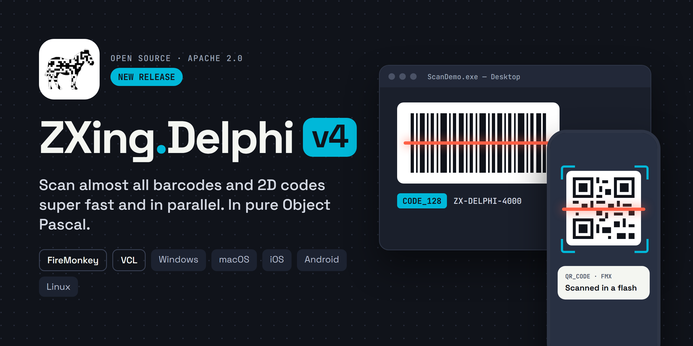
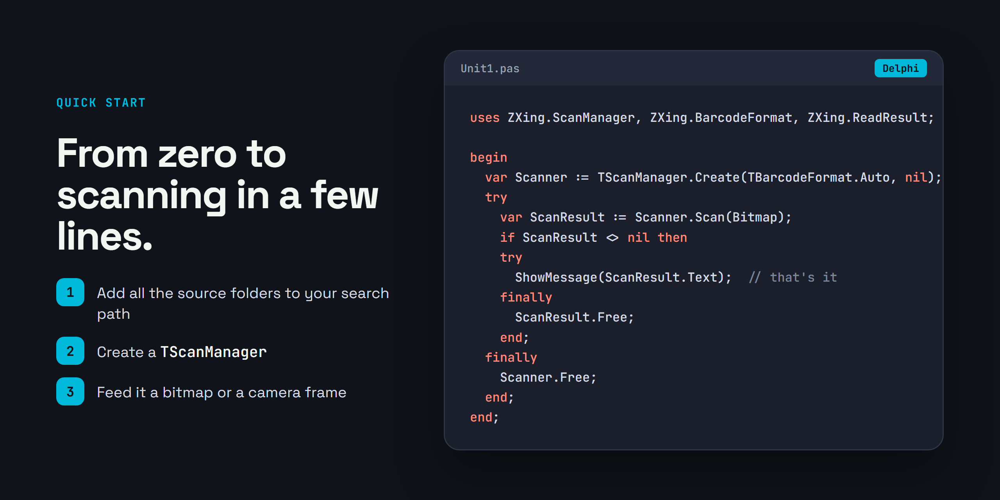
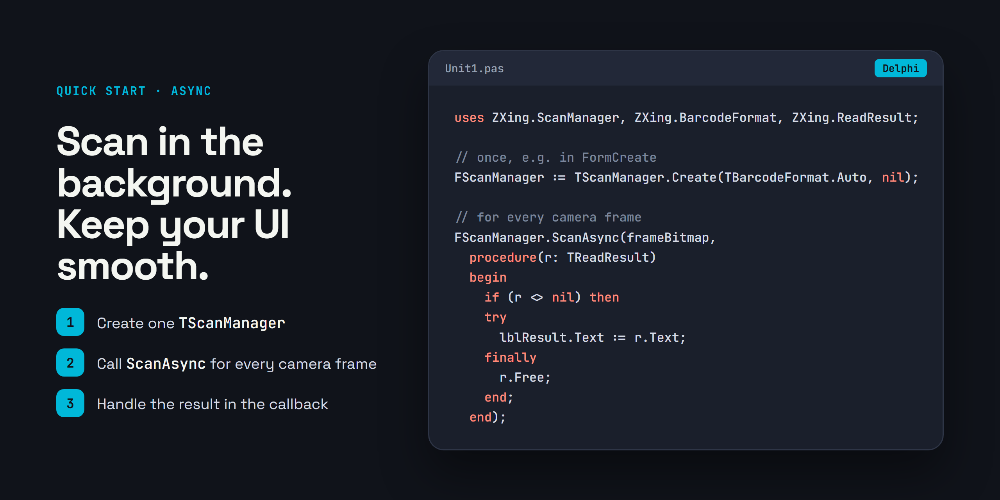

## What is it?
ZXing.Delphi is a native Object Pascal library that is based on the well known open source Barcode Library: ZXing (Zebra Crossing). This port was based on .Net ZXing and the Java one. From v4 it is based of the C++ port which had lots of better and faster scan strategies. See features and highlights. It is aimed at all of the FireMonkey platforms and, starting from v3.1, it fully supports also Windows VCL applications.

With this library you can scan with native compiled speed without the use of linking in external libraries and avoid compatibility issues and dependencies. It is fast. Its compatible with Delphi 10.4 Sydney - 13.x Florence (**for XE7 - 10.3 use v3.13.1**) and tested with the latest IOS, Android 32/64, Windows 32/64 and OSX.  

Just include the source files and add it in your existing projects and build the ZXing.Delphi source within your projects.

- Native compiled barcode scanning for all VCL and FireMonkey platforms (IOS/Android/Windows/OSX).
- 100% free. No license fees. Just free.
- Speed
- Simple API
- Unit tests provided
- Test projects provided


## What new in 4.0
ZXing.Delphi 4.0 is by far the biggest step since the port began. The library grew from 10 symbologies to 52: Aztec, PDF417 and MicroPDF417, Micro QR and rMQR, MaxiCode, the GS1 DataBar family and GS1 Composite, DotCode and Han Xin, the stacked codes Codablock F, Code 16K and Code 49, and the postal barcodes from KIX to Intelligent Mail, several of which no other ZXing port reads at all. The QR Code and Data Matrix detectors are ports of zxing-cpp, so perspective, curved and dot-peen codes that 3.x missed are read now, and an image pyramid catches the large and blurry ones. It is also much faster: the luminance conversion, binarizer and 1D readers were rewritten, and the readers run side by side in the tasks of a thread pool, so a frame is decoded on all cores. The API grew with it: one ScanAsync call scans a camera frame in the background and hands the result to the main thread, IScanManager frees itself, every result has the four corners of its code, and codes that are seen but not readable can be reported too. And there is a new demo app that shows all of it: a scanner with tracked outlines and a settings screen, built with the standard FMX components only. It is also much faster then the previous version: on the same images 4.0 scans about five times faster than 3.x on a single core, while trying five times as many formats, and on large camera frames the readers decode side by side on all cores. 


## Usage

If you use a Delphi older then 11.1 then you NEED to set a compiler Define in your 'project options->Delphi compiler->Conditional defines'. Set this in your target platforms or All platforms.  See demo applications.
- FRAMEWORK_VCL - this predefined variable is set to true if the project uses the VCL framework
- FRAMEWORK_FMX - this predefined variable is set to true if the project uses the FireMonkey (FMX) framework

The simplest example of using ZXing.Delphi looks something like this:



Create the scan manager once and use it for all frames; it is not meant to be used by two threads at the same time. Hints are passed as a dictionary, which the scan manager frees:

```Pascal

var hints := TDictionary<TDecodeHintType, TObject>.Create;
hints.Add(TDecodeHintType.TRY_HARDER, nil);        // slower, finds more (also rotated 1D codes)
hints.Add(TDecodeHintType.ENABLE_INVERSION, nil);  // also light codes on a dark background
FScanManager := TScanManager.Create(TBarcodeFormat.Auto, hints);

```





For a camera, scan in the background and get the result in the main thread (the bitmap may be reused as soon as ScanAsync returns; a frame that arrives while a scan runs is skipped; Scanning tells whether a scan runs):

```Pascal

FScanManager.ScanAsync(frameBitmap,
  procedure(r: TReadResult)
  begin
    if (r <> nil) then
    try
      lblResult.Text := r.Text;
    finally
      r.Free;
    end;
  end,
  procedure(e: Exception)
  begin
    lblResult.Text := e.Message;
  end);

```

All barcodes in an image, with the extra information of a result:

```Pascal

var list := FScanManager.ScanAll(scanBitmap);  // a TObjectList: frees the results
try
  for var r in list do
  begin
    Memo1.Lines.Add(r.SymbologyIdentifier + ' ' + r.Text);
    // r.Position: the 4 corners in the image, r.Orientation: the rotation in degrees
    if r.IsGS1 then
      Memo1.Lines.Add(r.GS1HRI);  // e.g. (01)05909990329717(17)270430(10)NE76571
  end;
finally
  list.Free;
end;

```

A QR Code or Data Matrix that was found but could not be read:

```Pascal

FScanManager.ReturnErrors := true;
var r := FScanManager.Scan(scanBitmap);
if (r <> nil) and (r.Error <> '') then
  // r.Text is empty, r.Position is where the code is: e.g. ask to hold the camera still or closer
  lblStatus.Text := 'Barcode found, but not readable (' + r.Error + ')';

```

Ofcourse the real world is not that simple. See the Demo app for a real world example. 

Andrea Magni also has a very nice blog post about an Android ZXing example from a training excerise of his. You can find it [here](https://blog.andreamagni.eu/2017/06/scannermapp-a-qrbarcode-scanner-app-with-delphi-zxing-and-tframestand/). 


### Tips and tricks - How to optimize an already fast library.
- Use autoformat scanning with care, with automatic on, every frame is passed to every barcode format. For example: If you want to scan only EAN-8, set the scan format for only EAN-8. 
- For mobile: try not to scan every frame, skip every n frame. Scanning 4 frames in a second should be good for most purposes. Safes CPU and battery. Look at the FMX example.
- For mobile: try setting your camera not to a high resolution. 640x480 is for most purposes perfect. More resolutions means more pixels to scan means slower. Saves CPU and battery.


## Supported Formats

All formats are read with TBarcodeFormat.Auto, except the ones marked "only when asked for" (choose them as TScanManager format or in the hint POSSIBLE_FORMATS).

### 2D

| Format | TBarcodeFormat | Also | Notes
| ------ | -------------- | ---- | -----
| QR Code | QR_CODE | Model 1 and 2, ECI, GS1, Structured Append | perspective and not flat symbols
| Micro QR Code | MICRO_QR_CODE | M1 to M4 |
| rMQR Code | RMQR_CODE | ECI, GS1 | rectangular Micro QR Code
| Data Matrix | DATA_MATRIX | square, rectangular and DMRE sizes, ECI, GS1, mirrored | dot-peen codes with TRY_HARDER
| Aztec | AZTEC | compact and full range, Aztec Runes, ECI, GS1, Structured Append, mirrored |
| PDF417 | PDF_417 | Compact PDF417, Macro PDF417, ECI |
| MicroPDF417 | MICRO_PDF417 | Macro PDF417, ECI |
| MaxiCode | MAXICODE | modes 2 to 6, ECI, Structured Append | with detector: anywhere in the image, rotated and in perspective (camera)
| DotCode | DOTCODE | all code sets, binary, macros 05/06/12, ECI, GS1 (]J1) | only when asked for (not in Auto); the dots found as blobs, the grid fitted to them: rotated, mirrored and in perspective (camera)
| Han Xin Code | HAN_XIN | versions 1 to 84, all data modes (numeric, text, binary, the Chinese regions and GB 18030 2- and 4-byte), ECI | only when asked for (not in Auto); with detector: anywhere in the image, rotated, mirrored and in perspective (camera)

### 1D

| Format | TBarcodeFormat | Also | Notes
| ------ | -------------- | ---- | -----
| UPC-A | UPC_A | 2 or 5 digit add-on | add-on with the hint ALLOWED_EAN_EXTENSIONS
| UPC-E | UPC_E | 2 or 5 digit add-on |
| EAN-8 | EAN_8 | |
| EAN-13 | EAN_13 | 2 or 5 digit add-on, ISBN (as EAN-13) |
| Code 39 | CODE_39 | Full ASCII (USE_CODE_39_EXTENDED_MODE), check digit (ASSUME_CODE_39_CHECK_DIGIT) |
| Code 32 | CODE_32 | | Italian pharmacy code; only when asked for (Auto: CODE_39)
| PZN | PZN | | German Pharmazentralnummer; only when asked for (Auto: CODE_39)
| Code 93 | CODE_93 | Full ASCII |
| Code 128 | CODE_128 | GS1-128 |
| ITF | ITF | ITF-14 (as ITF), any even length from 6 digits (ALLOWED_LENGTHS) |
| Codabar | CODABAR | start and stop characters with RETURN_CODABAR_START_END |
| Telepen | TELEPEN | full ASCII and compressed numeric |
| GS1 DataBar | RSS_14 | Omnidirectional, Truncated, Stacked, Stacked Omnidirectional |
| GS1 DataBar Expanded | RSS_EXPANDED | Expanded Stacked |
| GS1 DataBar Limited | RSS_LIMITED | |
| DX Film Edge | DX_FILM_EDGE | frame number |
| MSI | MSI | modulo 10 check digit (ASSUME_MSI_CHECK_DIGIT) | only when asked for
| Plessey | PLESSEY | | CRC checked; only when asked for
| Pharmacode | PHARMA_CODE | | Laetus one track; only when asked for
| Pharmacode two-track | PHARMA_CODE_TWO_TRACK | | Laetus two track, horizontal and vertical; at least 3 bars, of at least 2 kinds (bars of one kind do not tell where the other track is); only when asked for
| Code 11 | CODE_11 | 1 or 2 check digits (C, K) | check digit(s) checked, in the text; only when asked for
| Industrial 2 of 5 | INDUSTRIAL_2_OF_5 | check digit in the text | only when asked for
| IATA 2 of 5 | IATA_2_OF_5 | check digit in the text | only when asked for
| Matrix 2 of 5 | MATRIX_2_OF_5 | check digit in the text | also called Standard 2 of 5; only when asked for
| Datalogic 2 of 5 | DATALOGIC_2_OF_5 | check digit in the text | only when asked for

### Stacked

Rows of 1D characters, read in Auto with one scan for all of them. Horizontal, also upside down; vertical with TRY_HARDER (like the 1D codes).

| Format | TBarcodeFormat | Notes
| ------ | -------------- | -----
| Codablock F | CODABLOCK_F | 2 to 44 rows of Code 128 characters, row numbers, row checksums and K1, K2 checked; in Auto before Code 128 (its rows are Code 128 rows)
| Code 16K | CODE_16K | 2 to 16 rows of 5 Code 128 characters, the row numbers in the start and stop patterns, 2 check characters (modulo 107); GS1 (FNC1 first: ]K1)
| Code 49 | CODE_49 | 2 to 8 rows of 4 symbol characters, the row numbers in the parity, row checks and the symbol checks X, Y, Z; alphanumeric, shifts (ASCII) and numeric; GS1 (FNC1 first)

### GS1 Composite

In Auto, or asked for as GS1_COMPOSITE (then only composites).

| Format | TBarcodeFormat | Notes
| ------ | -------------- | -----
| GS1 Composite | GS1_COMPOSITE | the 2D component CC-A, CC-B (MicroPDF417) or CC-C (PDF417, with GS1-128) above an EAN-13, EAN-8, UPC-A, UPC-E, GS1 DataBar (Omnidirectional, Limited, Expanded) or GS1-128; also upside down; text: the linear text, '|' and the GS1 text of the 2D component (encodation methods 0, 10 and 11). Asking for the linear format only returns the linear text, as before


### Postal

Only when asked for, not in Auto. The ones of bars that differ in height (4-state, and POSTNET, PLANET and CEPNet): horizontal and vertical, upside down, slanted and in perspective.

| Format | TBarcodeFormat | Notes
| ------ | -------------- | -----
| KIX (PostNL) | KIX | starting with a Dutch postcode (it has no start or stop: that tells the direction)
| RM4SCC (Royal Mail 4-State Customer Code) | RM4SCC | check character checked, not in the text
| USPS Intelligent Mail Barcode | IMB | CRC checked; text: tracking code (20 digits) and routing code (ZIP, 0, 5, 9 or 11 digits)
| POSTNET (USPS) | POSTNET | 5, 9 or 11 digits, check digit checked, not in the text
| PLANET (USPS) | PLANET | 11 or 13 digits, check digit checked, not in the text
| Japan Post (Kasutama) | JAPAN_POST | postal code and address (with letters), check character checked
| Australia Post 4-State Customer Barcode | AUSTRALIA_POST | Standard, Customer Barcode 2 and 3, reply, routing and redirection; Reed-Solomon (errors corrected); text: format control code, DPID and customer information
| Royal Mail Mailmark 4-state (barcode C and L) | MAILMARK_4STATE | Reed-Solomon (errors corrected); text: format, version, class, supply chain ID, item ID and destination postcode plus DPS, as zint
| CEPNet (Correios, Brazil) | CEPNET | POSTNET of 8 digits (CEP), check digit checked, not in the text
| Korea Post | KOREA_POST | postal code of 6 digits and the check digit (checked; as printed below the bars); read as a 1D code
| USPS FIM (Facing Identification Mark) | FIM | A to E; no check: tall straight bars (at least 10 times their width) in a clear zone, horizontal and vertical
| Deutsche Post Leitcode | DP_LEITCODE | ITF of 14 digits, check digit (weights 4 and 9) checked, in the text; Auto: ITF
| Deutsche Post Identcode | DP_IDENTCODE | ITF of 12 digits, check digit (weights 4 and 9) checked, in the text; Auto: ITF

	
### Other barcodes?
Let me know ! 


### Changes
- 4.0.0
   	- New version, based on C++ ZXing, more then 50 decoders including postal barcodes, parallel decoding, it is also much faster: on the same images 4.0 scans about five times faster than 3.x on a single core, while trying five times as many formats, and on large camera frames the readers decode side by side on all cores
- v3.12.0
	- Data Matrix: rotated codes are read much more reliably. The number of modules is now counted through the centers of the outer modules instead of along the edge.
	- Data Matrix: better reading of dot-peen codes (codes made of separate dots). With TRY_HARDER the dots are merged as a last attempt; this is slower on images without a code.
	- Data Matrix: with the ASSUME_GS1 hint, a GS1 code starts with the symbology identifier ']d2' instead of ASCII 29 (GS). Without the hint nothing changes.
- v3.11.0
	- Data Matrix: codes that are not centered in the image are now found. The detector tries the center first and then a grid of start points. Small codes away from the center need the TRY_HARDER hint.
	- Data Matrix: fixed skewed corner detection for codes left of the image center.
- v3.10.1
	- Data Matrix: fixed decoding of codes with an EDIFACT segment followed by more data. https://github.com/Spelt/ZXing.Delphi/issues/180
	- Data Matrix: fixed upper shift (extended ASCII) characters in C40 and Text mode.
- v3.10.0 Improvements by René Hoffmann. https://github.com/Spelt/ZXing.Delphi/issues/143
	- Avoid unnecessary usage of 'class'-modifier keyword (refactoring only)
	- incorrect use of class var disrupts usage of multiple instances (e.g. in different threads) #174
- v3.9.13
	QR code: Fixed compute dimensions and more accurate results of sizeOfBlackWhiteBlackRunBothWays if outside of image. Replaced integer division with floating point division (Thanks ImperatorZurg).
- v3.9.12
	Fixed a bug in Bresenham's line algorithm
- v3.9.11
	Usage of FRAMEWORK_FMX and FRAMEWORK_VCL. See 'Usage' below.
- v3.9.8
	Fixes datamatrix https://github.com/Spelt/ZXing.Delphi/issues/162 and QR QRCode read error when contains when has char 10 https://github.com/Spelt/ZXing.Delphi/issues/163, pull requests with code optimization from EguitarRed and Rene Pastoors.
- v3.9.7
	updated fix for compatibility: https://github.com/Spelt/ZXing.Delphi/issues/143
- v3.9.6
	- Lots of fixes by Robert Jedrzejczyk https://github.com/Spelt/ZXing.Delphi/issues/142, https://github.com/Spelt/ZXing.Delphi/issues/143, https://github.com/Spelt/ZXing.Delphi/issues/144, https://github.com/Spelt/ZXing.Delphi/issues/145, https://github.com/Spelt/ZXing.Delphi/issues/146, https://github.com/Spelt/ZXing.Delphi/issues/147, https://github.com/Spelt/ZXing.Delphi/issues/148, https://github.com/Spelt/ZXing.Delphi/issues/149, https://github.com/Spelt/ZXing.Delphi/issues/150, https://github.com/Spelt/ZXing.Delphi/issues/151, https://github.com/Spelt/ZXing.Delphi/issues/152, https://github.com/Spelt/ZXing.Delphi/issues/153, https://github.com/Spelt/ZXing.Delphi/issues/154, https://github.com/Spelt/ZXing.Delphi/issues/156   
- v3.9.5
	- fix: overflow Android. https://github.com/Spelt/ZXing.Delphi/issues/136 
- v3.9.4
	- fix: when using TBarcodeFormat.Auto certain QRCodes causes integer overflow in EAN parser. https://github.com/Spelt/ZXing.Delphi/issues/133
- v3.9.3
	- Demo app is Alexandria/Android compatible (Thanks igorbastosib and Patrick Prémartin)
	- fix: Some boundary check added (Thanks igorbastosib)
	- fix: Segmentatition fault	(Thanks Macc2010)
- v3.9.2
	- Removal of advanced test app.
	- fix: Access Violation in Decode https://github.com/Spelt/ZXing.Delphi/issues/100
	- fix: ZXing.Common.BitMatrix Range Check Error - https://github.com/Spelt/ZXing.Delphi/issues/104
- v3.9.0
	- QRCode 64bit Android and IOS fix (Issue #93 and #62)
- v3.8.3
	- Some memleak fixes and simplified Advanced test app.
- v3.8.1
	- In 'Advanced demo' added Rio compatible Android camera optimizing library (thanks to E. van Bilsen). 
- v3.8
	- Fixed missing files for 'advanced test demo app', due to incompatibility with the external used libFastUtils.a and libfastutils-android.a it is not supported for Rio and Android.
	- Added in 'advanced test demo app' new Rio / Android 7+ code for the new permission model.
- v3.7
	- Changes in demo app. Asking Permissions to mobile users. 
- v3.6
	- Fixed QRCode bug and QR Memleak (thanks to C. Pradelli)
- v3.5 
	- Fixed a QRCode bug. Did not find the QRCode in some cases. Bugfix: https://github.com/Spelt/ZXing.Delphi/issues/65 
- v3.4
	- Added an advanced test app. Featuring faster camera, sound, barcode marker,warning for slow camera and a cool HUD. It makes use of huge camera performance tweak. See Readme in the uMain.pas and https://quality.embarcadero.com/browse/RSP-10592 
	- Little cleanup	
	
- v3.3.1 Date: 2017/01/08 (Thanks for Nano103)
	- Bug fix in Code39

- v3.3 Date: 2016/12/10 (Thanks for Nano103 for adding Code 39)
	- Added UPC-A, UPC-E, Code 39
	- Now Delphi is listed at the official zxing page: https://github.com/zxing/zxing	
	- Added tip section.

- v3.2 Date: 2016/11/27 
	- Added EAN8, EAN13 (many requests)
	- v3 becomes master branch

- v3.1 Date: 2016/06/28 (Super many thanks to: Carlo Sirna)
	- Added VCL support (via IFDEF USE_VCL_BITMAP).
	- Memleak fixes for old gen compilers (win32/win64).
	- Fix: QRCode ECI character set + extra unit test.
	- Added 'Load Image from file' command in test project.
	- UTF-8 fixed bug + added unit test
	- Some other bug fixes.

- v3.0 Date: 2016/04/28 (Great many thanks to: Kai Gossens and Raphael Büchler)
	- Massive folder restructuring
	- Added DataMatrix (centered only).
	- ResultPoint event added.
	- Support for inverted 1D/2D code types.
	- Better OneDReader scan strategy
	- Redesigned the file/folder structure for better namespacing.
	- Simplification of adding readers to the TMultiformatReader (just add all your readers here)
	- Small improvements.
	
- v2.4 Date: 2016/04/06
    - Fix in Code128 where code did not scan at all sometimes.    

- v2.3 Date: 2016/02/27
	- Fixed leaks.
    - Android added to compatibility list.

- v2.2 Date: 2016/02/21
	- Fixed IOS crash bug on 32bit only (ITF related).

- v2.1 Date: 2016/01/29
	- Implemented ITF (thanks p. b. Hofstede!) + unit test.
	- Fixed small bug.
	
- v2.0 Date: 2015/11/30
	- Implemented QR-Codes + unit test.

- v1.1 Date: 2015/7/11
	- Implemented Code 93 + unit test.

- v1.0
 	- Init upload
 	- Base classes 1D barcode implemented.	
 	- Implemented Code 128 + unit test.


### Thanks
ZXing.Delphi is a project that I've put together with the work of others.  So naturally, I'd like to thank everyone who's helped out in any way.  Those of you I know have helped I'm listing here, but anyone else that was involved, please let me know!

- The ZXing main project author - Sean Owen.
- J. Dick at Redth at https://github.com/Redth/ZXing.Net.Mobile
- Carlo Sirna
- P. B. Hofstede
- Kai Gossens
- Raphael Büchler
- Nano103
- René Hoffmann
- C. Pradelli
- E. van Bilsen
- igorbastosib
- Patrick Prémartin)

Did I miss anyone? Let me know!

### ZXing.Delphi
ZXing.Delphi is released under the Apache 2.0 license.
ZXing.Delphi can be found here:https://github.com/Spelt/ZXing.Delphi
A copy of the Apache 2.0 license can be found here: http://www.apache.org/licenses/LICENSE-2.0

### ZXing
ZXing is released under the Apache 2.0 license.
ZXing can be found here: http://code.google.com/p/zxing/
A copy of the Apache 2.0 license can be found here: http://www.apache.org/licenses/LICENSE-2.0

### ZXing.Net
ZXing.Net is released under the Apache 2.0 license.
ZXing.Net can be found here: http://code.google.com/p/zxing/
A copy of the Apache 2.0 license can be found here: http://www.apache.org/licenses/LICENSE-2.0
